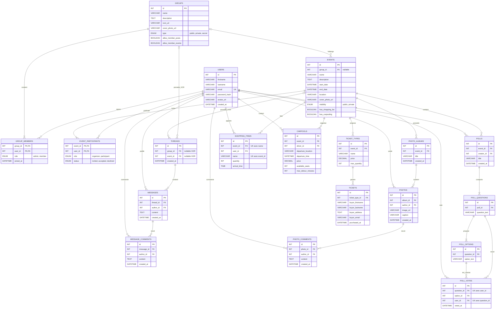

# my_social_network_api

TP sur la refonte des API d'un réseau social (type Facebook) visant à améliorer la réactivité, la fiabilité et les performances des services. Cette API REST couvre la gestion des utilisateurs, groupes, événements, interactions sociales (discussions, albums photo, sondages) ainsi que les modules de billetterie, shopping list.

## Fonctionnalités principales
* **Utilisateurs** : Gestion complète (CRUDS) avec unicité de l'email.
* **Groupes** : Groupes publics, privés ou secrets, gestion des rôles (administrateurs/membres) et permissions de publication.
* **Événements** : Création guidée, gestion des organisateurs/participants, visibilité et invitation automatique des membres d'un groupe.
* **Fils de discussion** : Liés exclusivement à un groupe ou à un événement, avec messages et commentaires.
* **Albums photo** : Associés à un événement, partage de photos et commentaires par les participants.
* **Sondages** : Création par les organisateurs, questions à choix multiples (1 seule réponse par participant et par question).
* **Billetterie** : Types de billets en quantité limitée pour les événements publics (1 billet max par personne extérieure).
* **Shopping list** : Liste d'éléments uniques à apporter par événement.
* **Covoiturage (Bonus)** : Proposition de trajets avec places disponibles, prix et temps d'écart maximum.

## Stack technique
* **Langage / Framework** : `[python][ex: Node.js / Express ou PHP / Symfony]`
* **Base de données** : `[ex: PostgreSQL / MySQL / MongoDB]`
* **Documentation** : Postman

Architecture BDD: 
## Installation et lancement
1. Cloner le dépôt :
   ```bash
   git clone https://github.com/martmartin1103-cyber/my_social_network_api
   cd my_social_network_api
   ```

## Modélisation de la base de données

